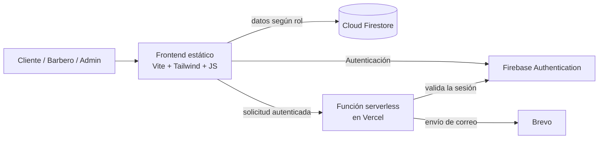

# ✂️ BarberPro — SaaS de Agendamiento para Barberías

**Plataforma web multi-barbero para reservas online, gestión de clientes y control financiero, con roles de usuario y notificaciones automáticas por correo.**

[**🔗 Ver demo en vivo**](https://saasbarberia.vercel.app)

---

> 🔒 **Código fuente privado.**
> Este repositorio es una **ficha técnica del proyecto**: describe qué hace, cómo está construido y qué tecnologías usa. El código vive en un repositorio privado porque BarberPro está pensado como producto comercial.
> Si eres reclutador, o una barbería interesada, puedo darte acceso de lectura al código o hacer una demostración en vivo. Contacto al final de este documento.

<!--
  💡 Tip: agrega capturas de la app.
  1) Crea la carpeta docs/ y sube las imágenes (reserva, agenda, finanzas)
  2) Descomenta y ajusta:
  
  

-->

## 🎯 ¿Qué problema resuelve?

Muchas barberías llevan su agenda en papel o en grupos de WhatsApp, pierden clientes por llamadas sin responder y no tienen claridad de sus números. BarberPro centraliza todo en una sola aplicación:

- Los **clientes** reservan online las 24 horas desde el celular.
- Los **barberos** gestionan su propia agenda, servicios y horarios.
- El **dueño** controla el equipo, los clientes y las finanzas del negocio.

## 👥 Roles de usuario

| Rol | Qué puede hacer |
|---|---|
| **Cliente** | Registrarse (correo o Google), reservar con el barbero y servicio que prefiera, ver su historial y cancelar citas con mensaje opcional |
| **Barbero** | Ver su agenda diaria, definir sus servicios y horarios, ver sus propias finanzas y recibir correos de nuevas reservas y cancelaciones |
| **Administrador** | Gestionar el equipo, asignar roles, ver métricas globales del negocio y acceder a la configuración general |

## ✨ Funcionalidades

**Para el cliente**
- Flujo de reserva guiado: barbero → servicio → fecha (próximos 7 días) → hora disponible.
- Horas ocupadas bloqueadas y sin posibilidad de reservar en horarios pasados.
- Límites anti-abuso en las reservas por cliente.
- Perfil con datos personales y selector de región y comuna de Chile.
- Historial de citas y cancelación con aviso al barbero.
- Ticket de reserva con enlace para agregar la cita a Google Calendar.
- Inicio de sesión con correo/contraseña o Google, y recuperación de contraseña.

**Para el barbero y el administrador**
- Panel de agenda diaria con confirmación y cancelación de citas (con aviso por correo al cliente).
- Recordatorio por WhatsApp a los clientes con un toque.
- **CRM de clientes**: ficha con historial, búsqueda, filtros y notas técnicas privadas.
- **Servicios y horarios independientes** por barbero.
- **Finanzas**: ingresos, gastos y ventas extras; utilidad neta; gráficos semanales, mensuales y anuales; ranking de barberos y popularidad de servicios.
- Gestión de equipo y cambio de roles (solo administrador).

**Transversal**
- **Correos transaccionales** con plantillas HTML: confirmación de reserva, nueva reserva para el barbero y avisos de cancelación.
- Diseño responsivo "Dark & Gold" pensado para usarse con una sola mano en el celular.
- Modales propios en lugar de los diálogos nativos del navegador.

## 🧱 Arquitectura

No hay servidor propio que mantener: el frontend es estático, Firebase se encarga de la autenticación y la base de datos, y una única función serverless envía los correos manteniendo la clave del proveedor fuera del navegador.

## 🛠️ Tecnologías

| Área | Herramientas |
|---|---|
| Frontend | HTML5, JavaScript (ES Modules), Tailwind CSS 3 |
| Build | Vite 5 con compilación multipágina |
| Autenticación | Firebase Authentication (correo y Google) |
| Base de datos | Cloud Firestore con persistencia local (IndexedDB) |
| Backend | Función serverless de Vercel (Node.js) |
| Correos | Brevo (API transaccional) |
| Gráficos e iconos | Chart.js · Lucide |
| Hosting | Vercel |

## 🧠 Cómo está hecho

**Modelo de datos (Firestore)**
Colecciones separadas para `usuarios`, `barberos`, `servicios`, `reservas`, `gastos`, `ventasExtras` y `configuracion`. Cada barbero tiene sus propios servicios y horarios, además de unos globales por defecto.

**Roles y permisos**
El rol de cada usuario se guarda en su perfil. Cada pantalla de staff pasa por una guarda de acceso que redirige a quien no tenga permiso, y la seguridad real se refuerza con reglas de Firestore del lado del servidor, para que el control no dependa solo del navegador.

**Flujo de reserva**
Se carga el barbero elegido y sus servicios, se calculan las horas disponibles cruzando su horario con las reservas existentes de ese día, se validan los límites por cliente y se guarda la reserva. Luego se envían los correos al cliente y al barbero.

**Notificaciones por correo**
El navegador construye el correo a partir de plantillas HTML (con escape de contenido) y lo envía a una función serverless. Esta valida la sesión del usuario contra Firebase, limita la frecuencia de envíos y llama a Brevo con una clave que solo existe en el servidor.

**Finanzas**
Las reservas completadas, los gastos y las ventas extras se agregan por periodo y por barbero para calcular utilidad neta, ticket promedio y los gráficos del panel. Un barbero solo ve sus propios números; el administrador ve los globales.

**Build multipágina**
La aplicación tiene 12 páginas HTML, cada una con su módulo de lógica. Vite las compila como entradas independientes y Vercel sirve rutas limpias.

## 🔐 Seguridad

- Autenticación gestionada por Firebase (sin guardar contraseñas propias).
- Control de acceso por roles en pantallas y en reglas de base de datos.
- Claves de terceros solo en variables de entorno del servidor.
- Endpoint de correo protegido por sesión, con límite de uso y validación de datos.
- Escape de HTML en lo que se muestra y en las plantillas de correo.

## 📬 Acceso al código y contacto

El código fuente es privado. Si quieres revisarlo, ver una demostración o conversar sobre usar BarberPro en tu barbería, escríbeme:

**Benjamín Alonso Medina Medel** — Concepción, Chile
[LinkedIn](https://www.linkedin.com/in/benjamin-alonso-medina-medel-56b9a23b6) · [Instagram](https://instagram.com/bnjmn.mdn) · contacto@benjaminmedina.cl

---

© 2026 Benjamín Alonso Medina Medel. Todos los derechos reservados. Este repositorio es solo documentación; el código y la marca BarberPro no están licenciados para uso, copia o redistribución.
